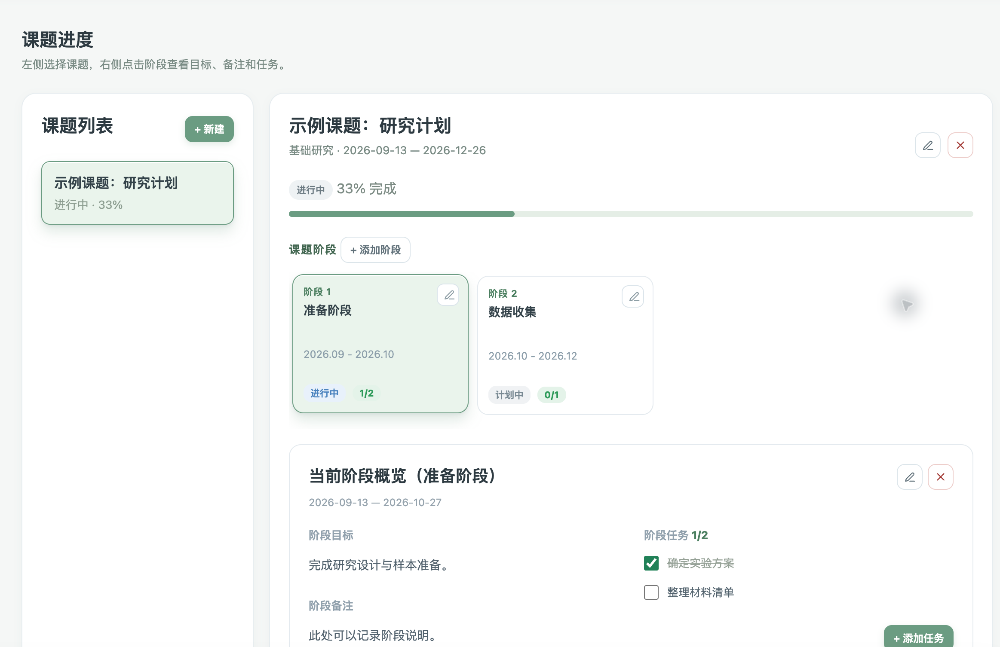
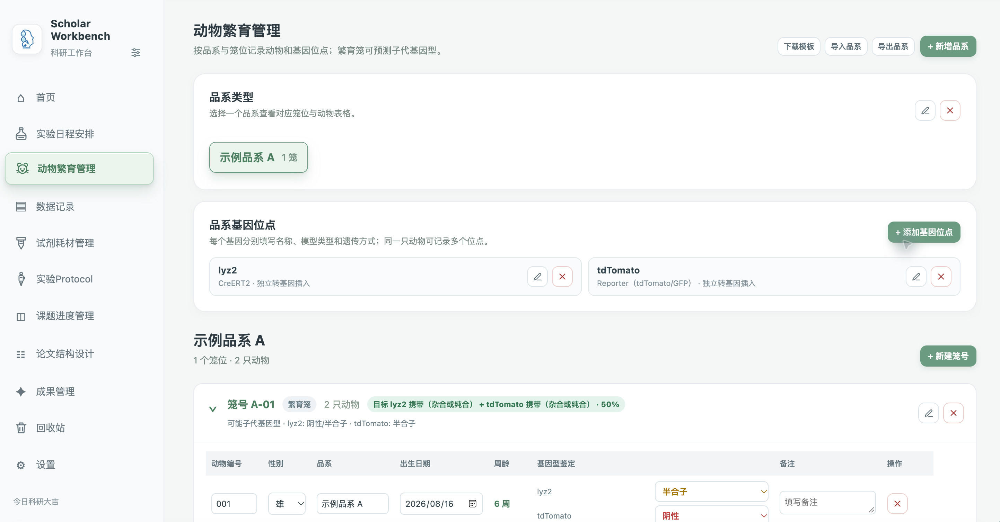
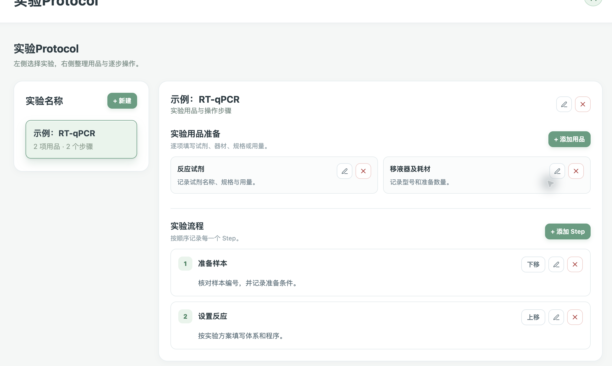
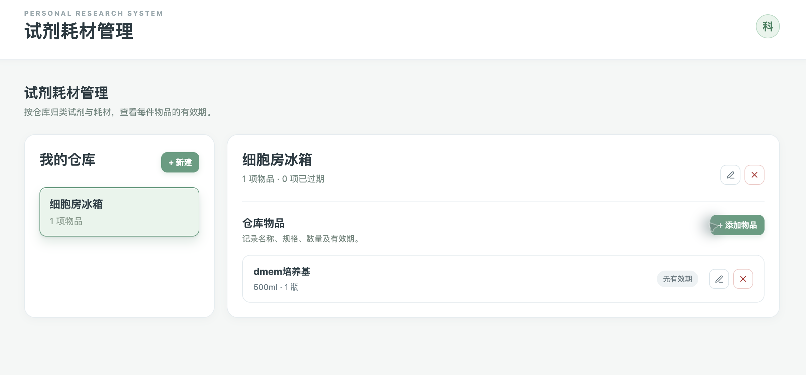

# Scholar Workbench

**把科研日常整理在一个本地工作台。** Scholar Workbench 提供实验日程、课题进度、动物繁育、实验 Protocol、试剂耗材、数据记录与成果管理。支持 macOS（Apple Silicon）和 Windows（x64）；记录保存在本机，可通过“完整同步”文件迁移。

## 功能预览

以下为软件界面截图，示例内容仅用于展示功能。

### 课题进度管理

左侧选择课题，右侧按时间查看各阶段。打开阶段后，可查看阶段目标、任务清单和完成进度，把长期课题拆成可以逐项推进的工作。

### 动物繁育管理

按品系管理基因位点、笼位和动物记录。可填写动物编号、性别、出生日期、基因型和备注，查看周龄及繁育笼的子代基因型预测；支持 Excel 模板导入、按品系导出和修改记录。

### 实验 Protocol

为常用实验建立自己的方法库。左侧切换实验，右侧分别整理实验用品和按顺序排列的操作步骤，方便查阅与更新。

### 试剂耗材管理

新建并命名仓库，按仓库记录物品名称、规格、数量和备注；需要时可设置有效期与过期日期。

## 其他功能

- **首页与科研日历：** 查看今日、明日及本周实验，记录每日打卡，设置重要日期倒计时。
- **实验日程安排：** 按日期添加实验，填写目的、步骤、结果及关联课题，并标记完成状态。
- **数据记录：** 按日期记录实验数据，可添加图片和文档附件。
- **论文结构设计：** 规划章节、小节与 Figure。
- **成果管理：** 整理论文、专利、学术会议、获奖、志愿服务等成果。
- **个性化设置：** 选择侧栏显示的模块，调整主题颜色和字体大小，设置实验提醒。
- **回收站：** 恢复误删内容或清空回收站。

## 下载与安装

从 [最新版本发布页](https://github.com/Hotpot959/Scholar-Workbench/releases/latest) 下载：

| 系统 | 安装文件 |
| --- | --- |
| MacBook（Apple Silicon） | Scholar-Workbench-*-macOS-Apple-Silicon.pkg |
| Windows（x64） | Scholar-Workbench-*-Windows-x64.exe |

发布页也提供 ZIP 文件。Mac 安装包由本机制作，未使用 Apple 开发者证书签名。

## 数据迁移

旧版软件中打开 **设置 → 完整同步**，导出同步文件；在新版软件的同一位置导入，即可迁移应用记录。跨设备迁移时也使用此文件。各模块导出的 Excel 文件适合查看或编辑对应内容，不能代替完整同步文件。

---

本APP由Jiawei Xing制作，祝各位实验顺利！
